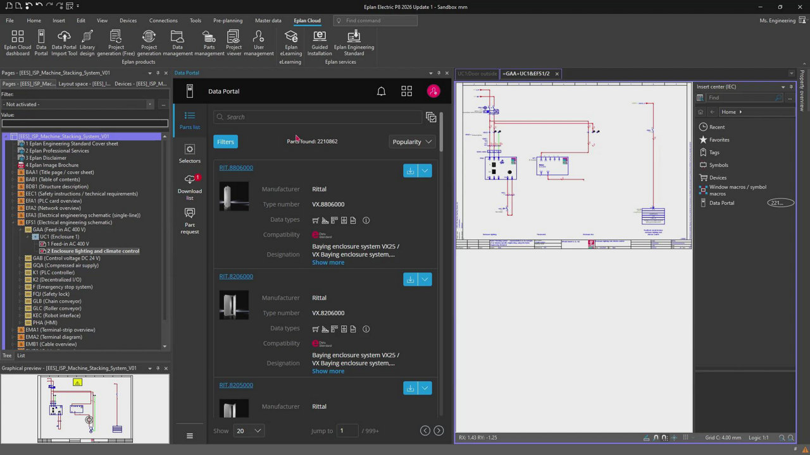
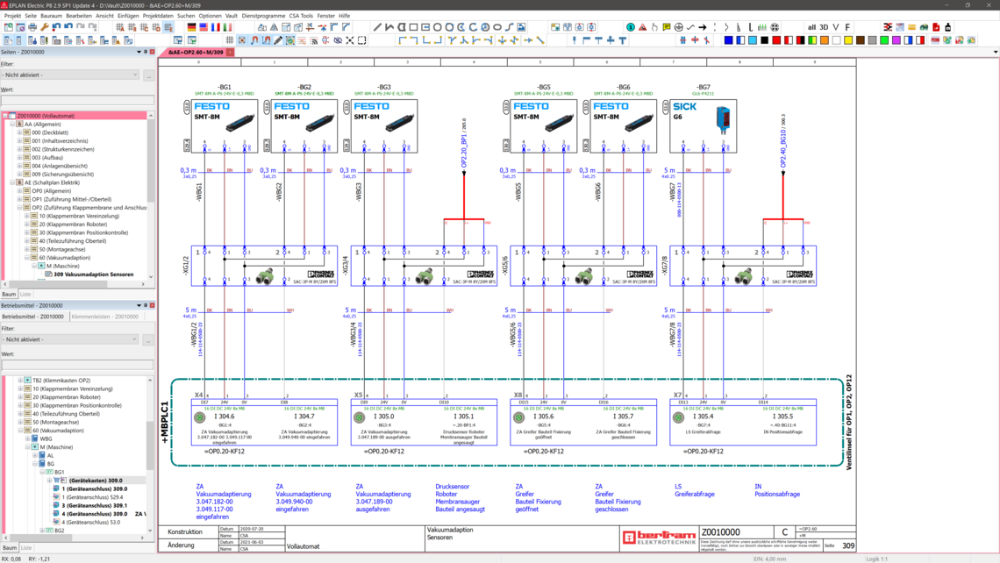

# EPLAN Electric P8 Intelligent Electrical Engineering Platform

EPLAN Electric P8 is professional ECAD software for designing and documenting electrical systems in machine building, plant engineering, automation, and control technology.

The platform connects schematic drawings with devices, cables, terminals, parts, reports, and project data. This model-driven approach helps engineers maintain consistent documentation as a design changes.

[](https://eplan-electric-p8.github.io/eplan-p8/)

## Product Overview

EPLAN P8 provides more than conventional drawing tools. Symbols and connections carry engineering data that can be evaluated throughout the project.

| Engineering area | Capabilities |
|---|---|
| Schematics | Standard symbols, logical connections, and cross-references |
| Devices | Device-driven design with technical and commercial data |
| Conductors | Automatic connections, numbering, and wire information |
| Quality | Online checks and project-wide consistency validation |
| Reports | Parts, cable, wire, terminal, and device documentation |
| Standards | Support for international and regional engineering workflows |
| Integration | Data exchange with ERP, PDM, and related EPLAN products |
| Collaboration | Access to cloud-based review and collaboration services |

Typical applications include:

- Industrial control systems.
- Machinery and production equipment.
- Control cabinets and panel building.
- Power distribution documentation.
- PLC connection diagrams.
- Pneumatic, hydraulic, cooling, and lubrication systems.



## Intelligent Schematic Design

EPLAN Electric P8 software treats placed components as engineering objects rather than unrelated graphical shapes.

A device can carry a tag, function text, part assignment, connection points, technical properties, and cross-references. When the device appears on several pages, its related information remains connected through the project model.

### Schematic Workflow

- Define project structure and drawing standards.
- Select page types and title blocks.
- Place symbols from approved libraries.
- Assign devices and manufacturer parts.
- Connect conductors and define potentials.
- Run project checks before releasing documentation.

Consistent templates reduce repeated configuration and help teams apply the same naming, page, layer, and report conventions across projects.

## Devices, Symbols, and Parts Data

The EPLAN Data Portal provides manufacturer-supplied device information for use in engineering projects. Available datasets can include commercial data, technical properties, schematic macros, connection information, and other product details.

Before approving a device:

- Confirm its manufacturer and part number.
- Review voltage, current, and environmental ratings.
- Check that connection definitions match the physical product.
- Verify that macros follow the project standard.
- Record approved alternatives where company policy allows them.

The open-source [definition_element.dtd](misc/definition_element.dtd) demonstrates how another ECAD tool defines electrical elements through XML. It is not an EPLAN schema.

## Connections and Numbering

EPLAN Electric P8 can create connections automatically when compatible connection points are arranged according to project rules.

Automated designation and numbering can cover:

- Devices and functions.
- Conductors and cables.
- Terminals and terminal strips.
- Plugs and connection points.
- Pages and structures.

Numbering rules should be agreed before detailed design begins. Late changes to designation structures can affect reports, labels, manufacturing data, and references across the project.



## Reports and Manufacturing Documentation

Project data can generate structured documentation without manually copying every value from a drawing.

| Report type | Typical purpose |
|---|---|
| Bill of materials | Purchasing and component preparation |
| Device list | Project-wide equipment overview |
| Terminal diagram | Terminal assembly and wiring |
| Cable list | Cable preparation and routing |
| Wire list | Connection and manufacturing information |
| PLC overview | I/O and connection documentation |
| Table of contents | Navigation through project pages |

A simplified BOM exchange file might contain:

```csv
device_tag,manufacturer,part_number,description,quantity
-K1,Example Controls,RC-24V,Control relay,2
-Q1,Example Electric,MCB-16A,Circuit breaker,1
-X1,Example Connect,TB-4,Terminal block,12
```

The actual fields and separators should follow the receiving ERP, purchasing, or production system.

## Project Checks and Verification

Online checks help identify incomplete or inconsistent engineering data during design. A formal project check should still be performed before documentation is released.

Review areas can include:

- Missing device or part assignments.
- Duplicate designations.
- Unconnected or incompatible connection points.
- Incomplete cable and terminal data.
- Invalid cross-references.
- Page and structure inconsistencies.
- Messages excluded by project-specific rules.

Engineering checks support review but do not replace electrical calculations, standards compliance, or professional approval.

## Standards and Multilingual Projects

EPLAN electrical software supports engineering workflows based on standards such as IEC and NFPA. Project templates, symbols, designation systems, forms, and reports should be selected for the target market.

Translation databases can help maintain multilingual project text. Technical reviewers should verify terminology, abbreviations, units, and safety-related wording in every released language.

The comparative [qelectrotech.sample.conf](misc/qelectrotech.sample.conf) shows configuration concepts from QElectroTech. It does not configure EPLAN.

## Integration and Automation

EPLAN Electric P8 Professional can participate in integrated workflows with other engineering and business systems.

Common integration targets include:

- ERP systems for commercial parts data.
- PDM or PLM systems for revision control.
- EPLAN Pro Panel for control cabinet engineering.
- Production systems for wiring and machining data.
- EPLAN Collaboration Apps for project review.
- Custom tools built with the EPLAN Platform API.

A documented EPLAN API pattern for opening a project is:

```csharp
Project project = new ProjectManager().OpenProject(
    "$(MD_PROJECTS)\\EPLAN_Sample_Project.elk"
);
```

API calls depend on the installed EPLAN version and licensed functionality. Offline applications also require the documented locking and runtime initialization sequence.

## File and Release Control

Released projects should be stored with clear status, revision, author, approval, and issue information.

PowerShell can calculate a checksum for an exported document:

```powershell
Get-FileHash "D:\EPLAN\Released\Machine-A.pdf" -Algorithm SHA256
```

This is a Windows system command, not an EPLAN command. A checksum can help confirm that a reviewed export was not changed during transfer.

## Open-Source ECAD Reference Files

EPLAN is proprietary software. The local files linked below come from QElectroTech, an independent open-source schematic editor, and do not contain EPLAN source code.

Project and build references:

- [CMakeLists.txt](CMakeLists.txt)
- [publiccode.yml](publiccode.yml)
- [qelectrotech.qrc](qelectrotech.qrc)
- [Doxyfile](Doxyfile)
- [cliff.toml](cliff.toml)
- [start_options.cmake](cmake/start_options.cmake)
- [developer_options.cmake](cmake/developer_options.cmake)
- [define_definitions.cmake](cmake/define_definitions.cmake)
- [find_spacemouse.cmake](cmake/find_spacemouse.cmake)

Format, configuration, and utility references:

- [qelectrotech.xml](misc/qelectrotech.xml)
- [register_filetypes.bat](misc/register_filetypes.bat)
- [make_icon_themes.py](misc/make_icon_themes.py)
- [qet_mcp.py](misc/qet-mcp/qet_mcp.py)
- [test_qet_mcp.py](misc/qet-mcp/test_qet_mcp.py)
- [plc_master_test.elmt](misc/qet-mcp/fixtures/plc_master_test.elmt)

The [qelectrotech.conf](misc/qelectrotech.conf) and [qelectrotech.appdata.xml](misc/qelectrotech.appdata.xml) files further illustrate application configuration and metadata in the reference project.

### Reference Build Configuration

The partial QElectroTech snapshot uses CMake:

```bash
cmake -S . -B build
```

This command configures the QElectroTech reference source. It does not install, activate, or automate EPLAN Electric P8.

## Licensing and Deployment

EPLAN offers subscription licensing with terms generally ranging from 12 to 36 months. Available configurations include single and concurrent licenses.

Deployment and package options can include:

- On-premises operation.
- Azure cloud environments.
- Product-specific feature packages.
- Annual platform updates.
- Technical support packages.
- Education access for eligible users.

EPLAN Education provides students and trainees with free private-use access, including Electric P8 and learning resources. Educational eligibility and permitted use should be checked through the current official terms.

## Frequently Asked Questions

### What is EPLAN Electric P8 used for?

It is used to design, document, verify, and manage electrical systems for machinery, plants, automation equipment, and control cabinets.

### Does EPLAN generate bills of materials?

Yes. Project and device data can produce parts lists and other reports such as terminal, cable, wire, and device documentation.

### Is EPLAN Electric P8 free for students?

Eligible students and trainees can obtain EPLAN Education licenses for private educational use through the official EPLAN program.

### Does EPLAN support ERP integration?

EPLAN provides integration options for ERP and PDM systems. The exact interface and required license depend on the target system and EPLAN package.

## Related Search Terms

eplan electric p8, eplan p8, eplan electric p8 software, eplan electrical software, eplan electric p8 professional, ecad, electrical-engineering, schematic-design, automation, control-systems, panel-building, bill-of-materials, wiring-diagrams, plc, engineering-software
